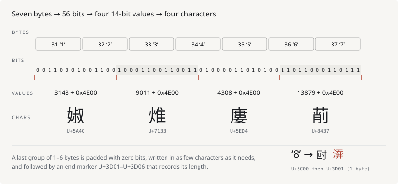
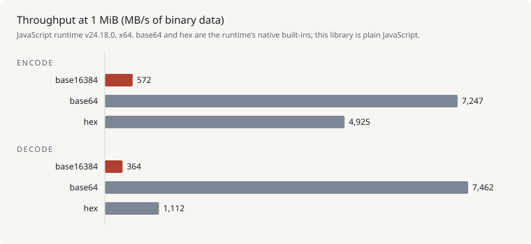

# base16384-js

Encode any data as printable CJK text in the base16384 format, and decode it back, in plain JavaScript with no dependencies.

```
"12345678"   →   婌焳廔萷尀㴁
```

base16384 writes 14 bits per character, using the 16384 code points from U+4E00 to U+8DFF. Seven bytes become four characters. Counted in characters, the result is far shorter than hex or base64, and its byte layout stays visible: a run of zero bytes shows up as a run of 一.

The output is compatible with the reference command-line tool in both directions. It has been checked against version 2.3.2 on every length from 0 to 200 bytes and on random inputs of up to 3 MB.



## Use it in a web page

Import the module straight from the published site. The `v1` path stays compatible for all 1.x releases.

```js
import { encode, decode, encodeText, decodeText } from "https://didvc.github.io/base16384-js/v1/base16384.mjs";

encodeText("12345678");          // "婌焳廔萷尀㴁"
decodeText("婌焳廔萷尀㴁");         // "12345678"
encode(new Uint8Array(7));       // seven zero bytes: "一一一一"
```

You can also copy `src/base16384.mjs` into your project. It is a single file and works in browsers, workers and server-side JavaScript runtimes.

## Functions

| function | does |
|---|---|
| `encode(bytes)` | bytes (`Uint8Array`, `ArrayBuffer`, typed array or number array) to a string |
| `encodeText(string)` | the string's UTF-8 bytes to a string |
| `encodeToUnits(bytes)` | bytes to a `Uint16Array` of code units, without building a string |
| `decode(text, { strict })` | a string or `Uint16Array` to bytes |
| `decodeText(text, { strict })` | to a string, failing if the bytes are not valid UTF-8 |
| `decodeDetailed(text, { strict })` | `{ bytes, warnings }`, for forgiving decoding |
| `encodedLength(n)` | number of characters for `n` bytes |
| `toUTF16BE(text, { bom })` | file bytes as the reference tool writes them, with the byte order mark unless `bom: false` |
| `readText(fileBytes)` | `{ text, encoding }` from a UTF-16BE, UTF-16LE or UTF-8 file |
| `new EncoderStream()` | a `TransformStream` from byte chunks to text chunks |
| `new DecoderStream()` | a `TransformStream` from text chunks to byte chunks |

Decoding ignores whitespace, so text that was wrapped, indented or pasted with line breaks still decodes. By default it is strict: any other foreign character, a missing or inconsistent end marker, or data after the end marker throws a `DecodeError`. The error carries a `code` and the `position` of the problem. Pass `{ strict: false }` to skip what cannot be read and collect the problems as warnings instead.

Streams produce exactly the same result as one-shot calls, wherever the chunk boundaries fall. To encode a file that a user picks:

```js
import { EncoderStream } from "https://didvc.github.io/base16384-js/v1/base16384.mjs";

const text = await new Response(
  file.stream().pipeThrough(new EncoderStream()).pipeThrough(new TextEncoderStream()),
).text();
```

## Command line

`bin/base16384.mjs` runs with a server-side JavaScript runtime (version 20 or later) and accepts the reference tool's options:

```sh
node bin/base16384.mjs -e photo.jpg photo.txt     # UTF-16BE with byte order mark, as the reference tool writes
node bin/base16384.mjs -en photo.jpg photo.txt    # the same without the byte order mark
node bin/base16384.mjs -d photo.txt photo-copy.jpg
echo -n 12345678 | node bin/base16384.mjs         # prints 婌焳廔萷尀㴁 in a terminal
node bin/base16384.mjs -dl damaged.txt out.bin    # forgiving: skip what cannot be read, warn
```

When the output goes to a terminal, the tool prints readable UTF-8 instead of UTF-16BE; `-u` asks for UTF-8 anywhere. Decoding reads UTF-16BE, UTF-16LE and UTF-8 input. The reference tool's checksum options `-c` and `-C` are not supported. `--help` lists everything.

## Compatibility

Text from the reference tool's encoder decodes to the same bytes here, and its decoder reads this library's output. For inputs smaller than about 64 KiB the encoded output is byte-for-byte identical. For larger inputs, only the unused padding bits of the last character can differ, and both decoders ignore them. This library is stricter about damaged input and more forgiving about whitespace and file encodings. [FORMAT.md](FORMAT.md) lists every difference.

## Speed

Plain JavaScript encodes several hundred megabytes per second on a typical computer. That is ample for files a person picks, but well below the native code behind the runtime's built-in base64 and hex. Run `make bench` to measure your own machine.



## Checking compatibility yourself

With a C compiler and `git`, `make reference` fetches and builds the reference tool 2.3.2 in an ignored folder. It is used only for comparison and is never part of this project. `make conformance` then compares the two on random data in both directions, and `make vectors` regenerates `test/vectors.json` from it. The same check runs on every push.

## Licence

Apache License 2.0, see [LICENSE](LICENSE). This implementation was written from the format's published description and shares no code with other implementations.

## Citing

See [CITATION.cff](CITATION.cff).

## Disclaimer

base16384-js is an independent, unofficial implementation of the base16384 format. It is not affiliated with or endorsed by the authors of the format or of the reference tool.

The format is a way of writing data down. It does not encrypt, hide or authenticate anything, and anyone can decode it. The software is provided as is, without warranty of any kind; see the licence for the full terms. Speed figures depend on the machine and are given as an illustration only.
